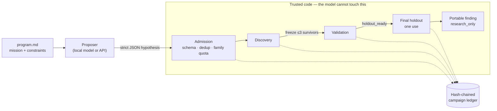

> **Reference implementation. The production research engine is private; this repository shows the method.**

# Autonomous Quant Researcher

**An LLM proposes trading hypotheses. Trusted code decides whether they are true.**

**Paper:** [Hard to Fool: A Bounded LLM Research Loop for Quantitative Finance, and What Two Dozen Campaigns Found](https://arxiv.org/abs/2611.06607) (arXiv:2611.06607). How to cite it is [below](#citation).

A bounded, resumable research loop for quantitative finance. A language model
proposes candidate hypotheses inside a fixed vocabulary; a deterministic
evaluator tests each one on immutable chronological data behind a
discovery → validation → one-use holdout wall; and a hash-chained ledger keeps
every trial, including the failures, which are most of them.

This is the method and the runnable skeleton, not a production desk. Data
adapters, licensed products, deployment surfaces, account state, and the
private research engine are deliberately out of scope.

**Live demo: [henryzhangpku.github.io/autonomous-quant-researcher](https://henryzhangpku.github.io/autonomous-quant-researcher/)**.
The real engine (`research/v3`, `research/backtest`) runs in your browser under
Pyodide on a synthetic tape with a scripted proposer. One regime is planted in
the discovery years and absent afterwards; discovery finds it, validation
refutes it. Nothing leaves your browser.

---

## The idea

Two projects published in 2026 made a simple point about agents: **the agent
is the cheap part; the loop around it is the product.**

| | [Karpathy's `autoresearch`](https://github.com/karpathy/autoresearch) | [Cobus Greyling's Loop Engineering](https://github.com/cobusgreyling/loop-engineering) |
|---|---|---|
| **What it is** | An agent edits one `train.py`, runs a fixed training job, keeps the change if the metric improved, and repeats. The instructions live in `program.md`, not in code. | A pattern library for the loop itself: `LOOP.md` and `STATE.md` as the persistent contract, budgets, deterministic gates, an audit trail, maker/checker separation. |
| **What this repo takes** | The fixed experiment contract: one candidate, one metric, one budget, keep or discard, and the discipline of programming the agent through [`program.md`](program.md). | The control surface in [`research/control/`](research/control/): lifecycle, state, budget, constraints, gate policy, and a run-log contract that forbids editing failures away. |

### Why a finance loop cannot be an ML loop

A hypothesis that improves a metric on historical data is usually overfit,
look-ahead, a multiple-comparisons artifact, a cost-free fiction, or drift
wearing a strategy. The loop therefore grew five properties the ML version does
not need:

1. **The model never writes executable code.** A v3 proposal is strict JSON: an
   entry minute, a bounded Boolean signal over approved causal observations,
   and one defined-risk structure. Trusted code interprets it. There is no
   executable-source field, so there is nothing to sandbox.
2. **Three chronological stages, one irreversible.** Discovery is for
   exploration. A frozen shortlist of at most three survivors goes to
   validation. The final holdout opens once, by explicit human action, after a
   durable receipt. A failed evaluation after the receipt still consumes it.
3. **Acceptance is a gate set, not a number.** Positive edge after base costs,
   positive net P&L, a positive weekly-cluster bootstrap lower bound, positive
   P&L under elevated costs, per-year stability, and sample floors. A ranking
   score chooses among gate-passers; it cannot admit one.
4. **Admission before evaluation.** Semantic duplicates, near-duplicates, and
   over-represented families are rejected before they spend a trial, so a
   50-trial budget buys 50 distinct ideas.
5. **The ledger is hash-chained and append-only.** Formulation failures,
   admission rejections, evaluator crashes, and results all stay. Edit, remove,
   or reorder an event and the campaign fails closed.

Two rules follow:

- **Budget exhaustion is not success.** Running out of trials pauses a mission;
  it never converts into a positive verdict.
- **No hand-authored strategy rules.** The human writes missions and evaluation
  policy; the loop writes the candidates.

The loop is the product. Individual experiments are disposable; the discipline
that governs them is not.

---

## Architecture



| Path | What lives there |
|---|---|
| [`program.md`](program.md) | The research program: immutable surface, mutable surface, the loop, the rules. |
| [`research/control/`](research/control/) | Loop Engineering documents: lifecycle, state, budget, constraints, gate policy, run-log contract. |
| [`research/autoresearch.py`](research/autoresearch.py) | The bounded, resumable experiment runner. Runs one declared command at a time, strips broker and provider credentials from the child environment, and never schedules or deploys. |
| [`research/v3/`](research/v3/) | The declarative contract: hypothesis vocabulary and trusted interpretation, staged campaign coordinator, gate evaluator, immutable stage stores, portable findings, and a typed actual-options evidence boundary. |
| [`research/lab/`](research/lab/) | Mission loading, proposer protocol (OpenAI-compatible), endpoint resolution, candidate memory, prior-evidence recall, and a natural-language idea compiler. |
| [`research/validators/`](research/validators/) | Fixed evaluators. Candidates cannot modify them. |
| [`research/backtest/`](research/backtest/) | Chronological options mechanics: sessions, structures, settlement payoff, modeled pricing, and data-quality guards. |
| [`research/providers/`](research/providers/) | Read-only data boundaries: optional market-data adapters, a deterministic snapshot writer, a generic licensed-provider interface, and a free public CSV example. |
| [`research/prereg/`](research/prereg/) | Pre-registered campaigns: a hash-chained ledger that binds a specification and its evaluation code before data exists, typed data requirements that refuse until met, and pure gates. |
| [`research/experiments/`](research/experiments/) | Data preparation scripts that produce hashed, gitignored snapshots. |
| [`research/missions/`](research/missions/) | Two reference missions: an options-interface example and a public-data pre-registration example. |
| [`research/hmm/`](research/hmm/) | An optional regime-model example with an illustrative, clearly fake risk wrapper. Not a production risk policy. |
| [`docs/AUTONOMOUS_QUANT_RESEARCH.md`](docs/AUTONOMOUS_QUANT_RESEARCH.md) | The full design contract. |
| [`demo/`](demo/) | The browser demo: board UI, a Web Worker running the engine under Pyodide, a synthetic tape, a scripted proposer, and the Pages build. |

---

## Data and the provider boundary

The method is deliberately provider-agnostic.

- **Public/free data is the default.** `research/providers/public_csv.py` loads
  a dependency-free CSV in the schema `date,open,high,low,close,volume`, with a
  tiny synthetic fixture at
  [`research/data/public/example_daily.csv`](research/data/public/example_daily.csv).
  The same loader works for a free export from a public source; no key, no
  network.
- **Licensed data is an interface, not a bundled client.**
  `research/providers/licensed.py` declares the record schema and the
  availability contract. A stub refuses every request with a typed error until
  a deployment injects an adapter that holds the licence. It never fills rows
  with placeholders.
- **No licensed or paid data file is committed.** Manifests and hashes are
  evidence; raw vendor rows are not part of this tree.
- **Proprietary flow, GEX, and dark-pool rows** stop at the typed import
  boundary in `research/v3/features.py`. This repository ships the boundary, not
  a vendor client.

---

## What it demonstrates

- Declarative hypothesis rejection before a trial is spent.
- Exact duplicate and near-duplicate admission.
- A frozen shortlist moving from discovery to validation.
- One-use holdout receipts, including crash-after-receipt behaviour.
- Hash-chained ledgers that fail closed on edit, reorder, or deletion.
- Weekly-cluster bootstrap uncertainty and multiple-testing-aware bars.
- Typed refusals when data requirements are not met.
- Credential stripping around candidate execution.
- A synthetic-tape demo where discovery finds a planted regime and validation
  refutes it.

The repository does **not** publish live results, client records, account data,
deployment details, or a production strategy. Example missions are there to
show the contract and the evidence format.

---

## Quickstart

Requires Python ≥ 3.12 and [`uv`](https://github.com/astral-sh/uv).

```bash
uv sync
python -m pytest -q
```

The suite is offline and needs no keys. It covers the declarative boundary,
stage isolation, hash checks, duplicate and diversity admission, absolute and
sample gates, one-use holdout receipts, provider contracts, portable-finding
authority, and the credential-stripping child environment.

**Choose a proposer.** The evaluator is deterministic CPU code; only the
proposer needs a model. Any OpenAI-compatible endpoint works. The reference
setup is `llama.cpp` serving a small coding model locally:

```bash
llama-server -hf Qwen/Qwen2.5-Coder-7B-Instruct-GGUF:Q4_K_M --host 127.0.0.1 --port 8080 -ngl 99 --ctx-size 8192

export AUTOQUANT_LAB_PROVIDER=auto        # auto | local | remote
export AUTOQUANT_LAB_BASE_URL=http://127.0.0.1:8080/v1
export AUTOQUANT_LAB_MODEL=Qwen/Qwen2.5-Coder-7B-Instruct-GGUF:Q4_K_M
uv run python -m research.cli llm         # prints which runtime will be used, and why
```

For a remote proposer, set `LLM_BASE_URL`, `LLM_MODEL`, and `LLM_API_KEY`, and
`AUTOQUANT_LAB_PROVIDER=remote`. Model choice never changes the evaluator, so
switching runtimes cannot move a metric; only who proposes the candidate.

**Run the options example:**

```bash
uv run python -m research.cli run \
    --mission research/missions/spy-0dte/mission.md \
    --policy  research/missions/spy-0dte/policy.toml

uv run python -m research.cli status --mission ... --policy ...   # durable loop state
uv run python -m research.cli pause  --mission ... --policy ...   # stops before the next attempt
```

State lives under `.research/runs/<mission>/` as an append-only `runs.jsonl`
plus content-addressed candidates. Every terminal stop writes a
`shutdown-report.md` listing every attempt, so an interrupted run still leaves
usable evidence.

The lower-level runner is `python -m research.autoresearch
{init,run,status,pause,resume}` over a TOML config; `research/cli.py` is the
mission-shaped front door.

---

## Pre-registration example

[`research/missions/gpu-leads-revisions`](research/missions/gpu-leads-revisions/PREREGISTRATION.md)
turns a public-data idea into a locked test. The signal, basket, outcomes,
horizons, stage dates, gates, and decision rule are frozen in
[`preregistration.json`](research/missions/gpu-leads-revisions/preregistration.json).
That file, its human-readable document, and the code that will compute the
verdict are bound by SHA-256 into a hash-chained
[ledger](research/missions/gpu-leads-revisions/ledger.jsonl). A receipt is
written before evaluation reads any data, and the evaluation is judged once.

The campaign currently refuses, by design: its licensed history is not held.
The refusal is typed and names the missing requirements. See
[`docs/AS_OF_DISCIPLINE.md`](docs/AS_OF_DISCIPLINE.md) for the point-in-time
rules the outcome side follows.

---

## What is deliberately not here

- The private production engine and its strategy library.
- Proprietary vendor clients and any licensed/paid data file.
- A web gateway, notifications, or a hand-off into a live signal registry.
- Broker credentials, account state, host names, deployment recipes, or
  production risk limits.
- Market-data blobs; manifests and hashes are committed, data is regenerated.

The reference HMM example includes a risk wrapper with **fake example
limits**. Replace them with explicit limits for any real deployment; they are
not a house policy.

---

## Acknowledgments

- **Andrej Karpathy — [`autoresearch`](https://github.com/karpathy/autoresearch)** (MIT).
  The fixed experiment contract and the idea that the researcher programs a
  `program.md`, not a codebase.
- **Cobus Greyling — [Loop Engineering](https://github.com/cobusgreyling/loop-engineering)** (MIT).
  The loop as a first-class artifact: `LOOP.md`, `STATE.md`, budgets, gates,
  audit, maker/checker.
- **Alpaca** for historical equities and options data, and the public market-data
  adapters for optional secondary sources.

Nothing here is a fork of either project; both are cited because the design
would not exist without them.

---

## Citation

If you use this work, please cite the paper:

> Henry Zhang. *Hard to Fool: A Bounded LLM Research Loop for Quantitative
> Finance, and What Two Dozen Campaigns Found.* arXiv:2611.06607, 2026.
> https://arxiv.org/abs/2611.06607

```bibtex
@misc{zhang2026hardtofool,
  title         = {Hard to Fool: A Bounded {LLM} Research Loop for Quantitative Finance, and What Two Dozen Campaigns Found},
  author        = {Zhang, Henry},
  year          = {2026},
  eprint        = {2611.06607},
  archivePrefix = {arXiv},
  primaryClass  = {q-fin.CP},
  url           = {https://arxiv.org/abs/2611.06607}
}
```

## Disclaimer

Backtests are hypothetical, research-only evidence. Nothing in this repository
is investment advice, a trading signal, or a recommendation to transact. Past
simulated performance does not predict future results.

---

## Author

**Henry Zhang** — quantitative engineer; fifteen years building research platforms and production trading systems, including eight years at BlackRock and two at PIMCO.

[LinkedIn](https://www.linkedin.com/in/henryzhang99/) · [GitHub](https://github.com/henryzhangpku) · [Substack](https://henryzhang.substack.com) · [officialhenryzhang.com](https://www.officialhenryzhang.com)

More work: [research2prod](https://github.com/henryzhangpku/research2prod) (research code that is already production code) · [mft-engine](https://github.com/henryzhangpku/mft-engine) (one Rust code path for backtest and live) · [GPU price index](https://github.com/henryzhangpku/gpu-price-index) (a daily benchmark built like a settlement index) · [all repositories](https://github.com/henryzhangpku?tab=repositories)
